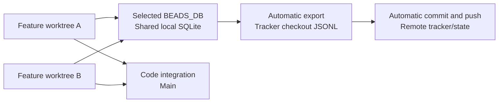
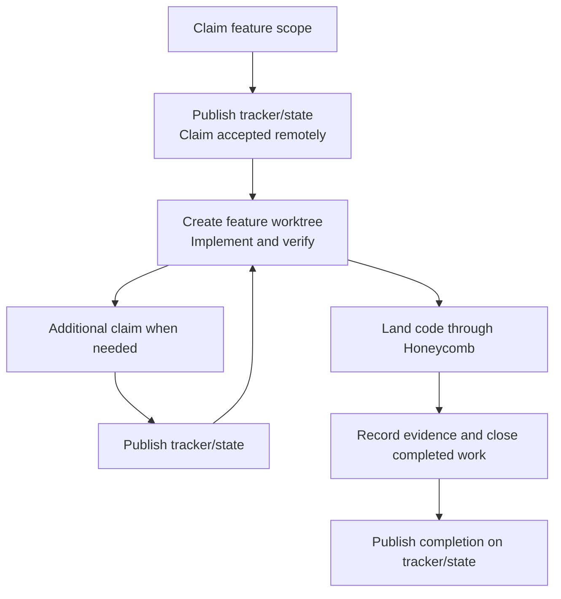

# Beads integration

Hive keeps its live tracker in a permanent full checkout at `.worktrees/tracker--state`, on branch `tracker/state`. Its ignored `.beads/beads.db` is shared by all local feature worktrees. Its tracked `.beads/issues.jsonl` is the snapshot exchanged with colleagues. Separate clones have separate databases and tracker checkouts.

This separates task publication from code integration. Beads can automatically export every mutation without dirtying main or requiring tracker commits on a protected code branch. Honeycomb handles feature worktrees and code integration; `br` handles SQLite and JSONL; the configured `br` wrapper receives compatible tracker changes, reconciles storage and publishes the combined snapshot before and after each successful command. `bun run beads:sync` runs the same checkpoint explicitly. Beads Rust does not implement Git sync branches merely because it recognizes the legacy `sync-branch` configuration key.



The database lives in a local checkout, not in Git. Git carries JSONL, tracker configuration and the history of published snapshots. Code branches carry no competing live tracker snapshot. The former synchronization hooks, which created private worktree databases and staged tracker changes during unrelated Git operations, are removed; normal code quality and commit-message hooks remain.

## Selecting storage

Configure the endpoint once per checkout:

```sh
bun run beads:setup --db /absolute/hive/.worktrees/tracker--state/.beads/beads.db
```

Setup preserves unrelated TOML settings and writes the selection to ignored `mise.local.toml` and the ignored Codex project configuration at `.codex/config.toml`. Mise is the project environment authority; Codex receives the same value through `shell_environment_policy.set`. `bun install` automatically inherits the canonical checkout's resolved mise selection for new Honeycomb worktrees; `bun run beads:setup --source <canonical-root>` repeats that setup explicitly. Local mise `activate_aggressive` makes project tool paths take precedence and keeps the persistent tracker checkout's `br` wrapper ahead of inherited system paths. Codex uses non-login command shells (`allow_login_shell = false`) so login startup cannot reorder that projected PATH. Environment consumers also normalize the wrapper to the front after mise resolution. Consumers honor `BEADS_DB` rather than deriving another database path from their working directory.

Setup selects an existing database. In a fresh clone, create the permanent tracker checkout from the accepted tracker branch, then use the native executable with `--db /absolute/tracker/.beads/beads.db` to run `sync --import-only` followed by `sync --flush-only`. Import creates SQLite from the accepted JSONL; flush establishes the local three-way merge base. Run setup afterwards, before any local mutation. Existing agent sessions retain their previous environment; restart them or run through `mise exec -- br` until restarted.

The tracked `.envrc` projects mise into direnv after its normal local approval. Claude's SessionStart hook exports the selection into its shell environment; Pi's local extension sets its process environment. Codex reads the ignored project config. Review the repository's two Codex hooks through native hook review once per clone; linked worktrees share the main checkout's hook source and trust. Hooks check tracker health before every tool: unresolved local conflicts block immediately, while active sessions check the remote at most 30 seconds apart. A stopped session needs reviewed recovery from a separate human terminal; its tool gate stays closed until tracker synchronization succeeds.

The tracker checkout has automatic import and export enabled. Routine mutations become visible to local workers immediately and normally update its JSONL too. An explicit publication flush still matters: it checks that export succeeded and refreshes the merge base, which automatic export does not do. Beads Viewer uses the same selected storage.

## Claims and completion

Claim the highest feature bead whose scope is intended to be exclusive before creating its feature worktree and starting implementation. The configured `br` command publishes the claim before returning success. If active work needs another bead, claim it the same way before starting its scope; the existing feature checkout stays untouched. Progress notes and completion commands also publish automatically.



Publication includes the shared database's current snapshot, including other agents' ongoing tasks. Exporting a task does not close it. Code integration and tracker publication are separate commits and pushes; landing is complete after both succeed. Never merge `tracker/state` into main to publish task state.

A parent claim does not assign its children or enforce a subtree lock. Reserve the stated feature scope by agreement, claim or delegate children explicitly, and leave a shared epic available as an aggregation of colleagues' features. Different actors' claims are checked transactionally within one database. Hive currently uses harness names, so two Codex sessions share an actor and can reclaim idempotently; scope and worktree notes distinguish competing sessions from continuations. Owner remains `ct` under repository policy and is separate from the assignee.

## Publishing and receiving colleagues' work

Use `bun run beads:sync` from a configured code checkout. It preserves local tracker work, fetches the configured tracker upstream, combines compatible changes, reconciles SQLite and publishes the combined snapshot without force. Updates to different tasks can be exchanged automatically while their feature code remains in separate worktrees. A conflicting record or claim stops synchronization and reports the state that needs review. Configured agents stop tool work until a human resolves the tracker from a separate terminal.

Automatic export often leaves the tracker checkout dirty when another contributor publishes. Local changes must therefore be preserved before incoming Git content is integrated. For manual conflict recovery, the sequence is:

1. Keep local tracker writers paused. Before integrating incoming Git content, explicitly flush current SQLite and commit the tracker JSONL locally. This preserves local work and establishes its database merge base.
2. Inspect accepted remote reservations and integrate the tracker commits using the Git JSONL merge driver. It combines independent records and surfaces incompatible same-record changes. Resolve disputed records deliberately, preserving unrelated work from both sides.
3. Use the native executable with the selected `--db` to inspect `sync --status --json`, then run unforced `sync --merge`. This reconciles SQLite, validates JSONL and resumes any interrupted synchronization receipt, even when `jsonl_newer` is false. Commit any resulting snapshot changes and run `bun run beads:sync` successfully before resuming tracker writers.

`jsonl_newer` reports a change from the last certified content hash, not timestamp order. Auto-import can skip independently changed SQLite and JSONL with a warning; an export can overwrite changed fields of an existing task. Do not wait for export to refuse before reconciling. A missing merge base with already-diverged state, or an unresolved database conflict, needs reviewed recovery rather than a forced sync.

Separate clones can both claim the same task locally. Claims remain provisional until a push is accepted. After a rejected push, yield to an already-published competing reservation; do not choose ownership by the newest timestamp or force. Overlapping parent and child reservations affect different records and can merge cleanly, so inspect scope as well as assignment. Reviewed Git conflict resolution may select existing complete JSONL records; routine task edits belong in `br`.

## Checkout maintenance

The tracker checkout is permanent: keep it out of worktree pools and ordinary finish/remove cleanup. Its database, local history and pending work must survive feature checkout deletion. Preserve older private databases until their unpublished state has been reconciled; selecting a different endpoint does not migrate them.

A full checkout supplies the relative Git merge-driver script and normal Husky tooling. Maintain those files deliberately with the relevant tooling commits. Do not routinely merge main into the tracker branch: code branches remove the live `.beads` state. A minimal or orphan tracker branch would need its own hook and merge-driver setup.

The migration and environment integration are tracked by `hv-rgr`; the earlier storage and synchronization research is recorded on `hv-3x8.1` and `hv-3x8.13`.
