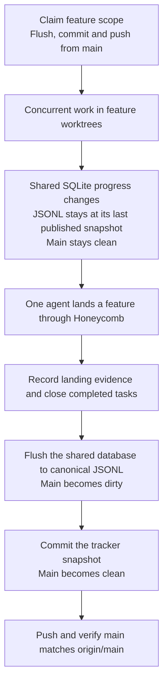
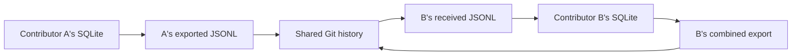

# Beads integration

Hive uses one Beads SQLite database per local repository, shared by its linked worktrees. SQLite holds live task state; `.beads/issues.jsonl` is the snapshot exchanged through Git. Separate clones have separate databases.

This document records the rationale and expected behavior. Repository policy lives in `AGENTS.md`; the land skill owns the publication procedure.

## Why publication is deliberate

Beads Rust normally writes a mutation to SQLite and automatically exports JSONL during the same command. From a fresh linked worktree, its default discovery selects the canonical checkout's storage. An existing private worktree database can change that selection, so Hive agents explicitly select canonical storage through their process environment.

Hive enables automatic import and disables automatic export. Task updates therefore persist locally and are visible to agents in other worktrees immediately, while canonical main remains clean for Honeycomb. Agents deliberately publish new claims before starting their scope and completion after feature integration. Honeycomb remains responsible for Git lifecycle operations and needs no Beads-specific behavior.

The previous Git hooks initialized a private database in each worktree and reconciled or staged JSONL during checkout, installation, commits and merges. That split live coordination across databases and coupled tracker publication to unrelated Git operations. Those synchronization hooks are removed; formatting, lint, type checks, conflict checks and commit-message validation remain.

## Claim checkpoints, routine work and landing

Before starting a feature, receive the accepted tracker state, claim its exclusive feature scope, and publish that claim from canonical main. Create the worktree and start only after the push succeeds. Several claims can share one checkpoint. When an active feature needs more work, publish the additional claim from main before starting that scope; the feature's code, Git HEAD and tracked JSONL remain untouched.

Feature work can run concurrently; landing and tracker publication are serialized per local repository. A publication checkpoint temporarily dirties main, then its commit and push restore clean, synchronized state. Honeycomb can push the feature integration first, followed by a separate tracker commit and push. Landing is complete only after both the code and tracker publication succeed.

The snapshot includes every task's current state, including work in progress on other branches. Exporting a task does not mark it complete. An older feature branch with an unchanged JSONL snapshot does not replace newer main state during a normal Git merge.

Claim the highest feature bead whose scope is intended to be exclusive. A parent claim does not assign children or enforce a subtree lock; the reservation is a team convention, and children are claimed or delegated explicitly. A broad epic shared by colleagues remains an aggregation of their separate features.

| Operation | SQLite | JSONL | Canonical Git state |
| --- | --- | --- | --- |
| Create, claim, update or close a task | Changes immediately | Unchanged | Clean |
| Commit feature code | Unchanged | Unchanged | Clean |
| Integrate feature code | Task state unchanged until recorded | Unchanged when the feature has no tracker edits | Clean after integration commit |
| Explicit flush | Current task state exported | Changes when the snapshot differs | Dirty |
| Commit tracker snapshot | Unchanged | Recorded in Git | Clean, possibly ahead of origin |
| Push | Unchanged | Published to the remote | Clean and synchronized |

SQLite remains persistent between exports. Git backup and visibility to other clones lag until the next publication. Claim checkpoints share intent before work begins; routine progress notes can wait until a later checkpoint. Beads Viewer can read canonical SQLite directly, so local prioritization does not require an export; its normal loader chooses the freshest valid SQLite or JSONL source.

## Working with another contributor

A contributor first fetches and integrates accepted remote main, then checks synchronization status before ordinary tracker commands can auto-import. When canonical JSONL differs from its last certified generation, unforced three-way reconciliation must precede reads, new claims or exports, even when the database reports no pending export. Reconciliation itself writes SQLite and JSONL; finish publishing its result before asking Honeycomb to operate on clean main. Repeat this check after integration, which can receive additional remote changes.

Updates to different tasks can be combined. Concurrent edits to the same task may require conflict resolution. Auto-import can skip independently changed SQLite and JSONL with a warning, while direct export can still overwrite changed fields of an existing task. An export refusal is therefore insufficient protection for incoming claims.

Both contributors can claim a task locally before exchanging snapshots. A claim is provisional until its push is accepted; after a rejected push, inspect the accepted remote reservation and yield to an already-published competitor. Combine unrelated changes and retry publication. Do not resolve ownership by the newest timestamp or a forced sync. Overlapping parent and child reservations affect different records and may merge cleanly, so scope checks remain necessary.

Within one shared database, claims by different actors are checked transactionally. Hive currently uses harness names as actors, so two Codex sessions have the same identity and may reclaim idempotently. Record the intended scope and worktree in notes; unique session identities are a separate part of the agent-identity epic. Owner identifies the responsible human and remains `ct` under current repository policy; it is independent of the assignee and does not reserve a task.

A fresh clone imports the accepted JSONL and performs an ordinary flush before its first local mutation, establishing a local three-way merge base. An already-diverged database without that base requires reviewed recovery; forcing a merge or inventing an ancestor can discard valid work.

The custom Git merge driver remains responsible for JSONL changes published on both sides. It combines compatible records and surfaces conflicts; database reconciliation still belongs to Beads Rust.

## Existing worktrees

Private databases created by the former hooks remain valuable records. Preserve them and inspect unpublished state before deleting their worktrees; changing database selection does not migrate or preserve files subsequently removed by cleanup. Existing branches also need the current hook and publication policy before continuing this workflow.

Do not replace canonical JSONL with an older worktree snapshot or rebuild canonical SQLite from it. Fresh worktrees need no private database initialization.

The discovery and synchronization research is recorded on bead `hv-3x8.1`; the policy change and concurrent landing verification are tracked on `hv-3x8.13`.
